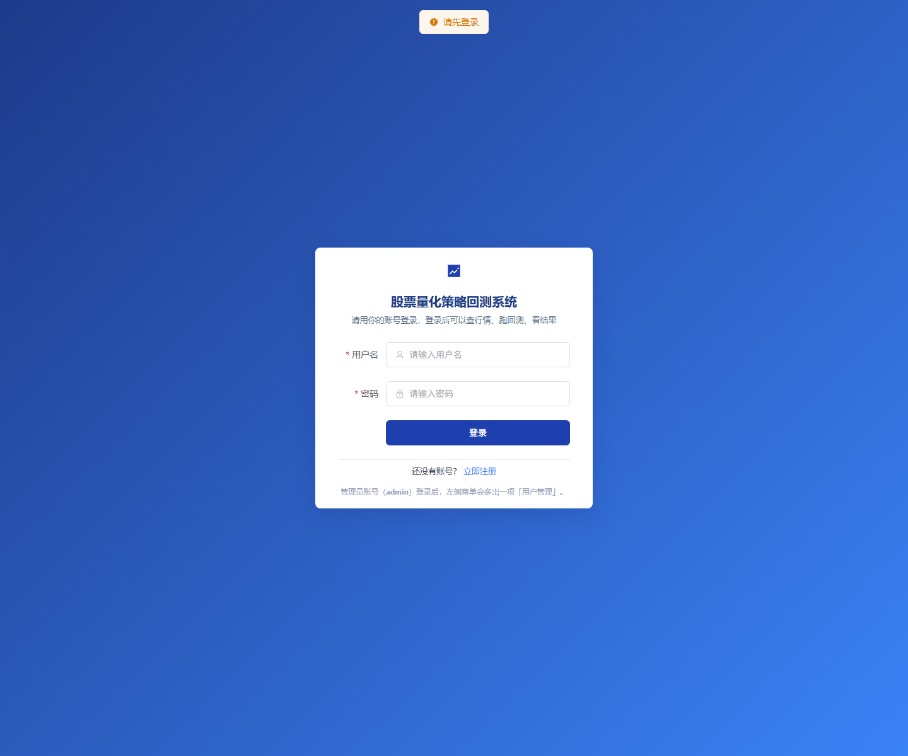
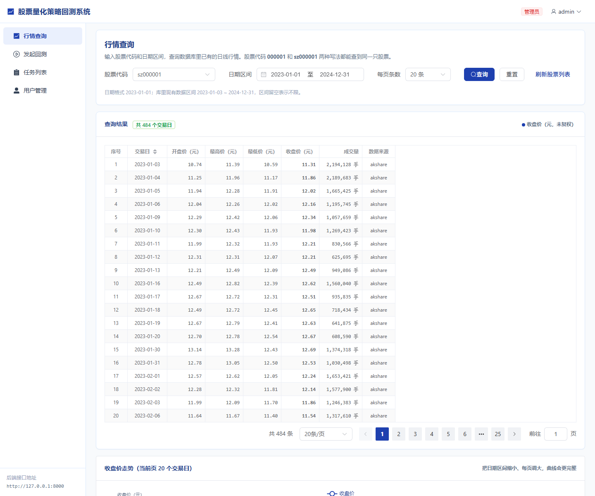
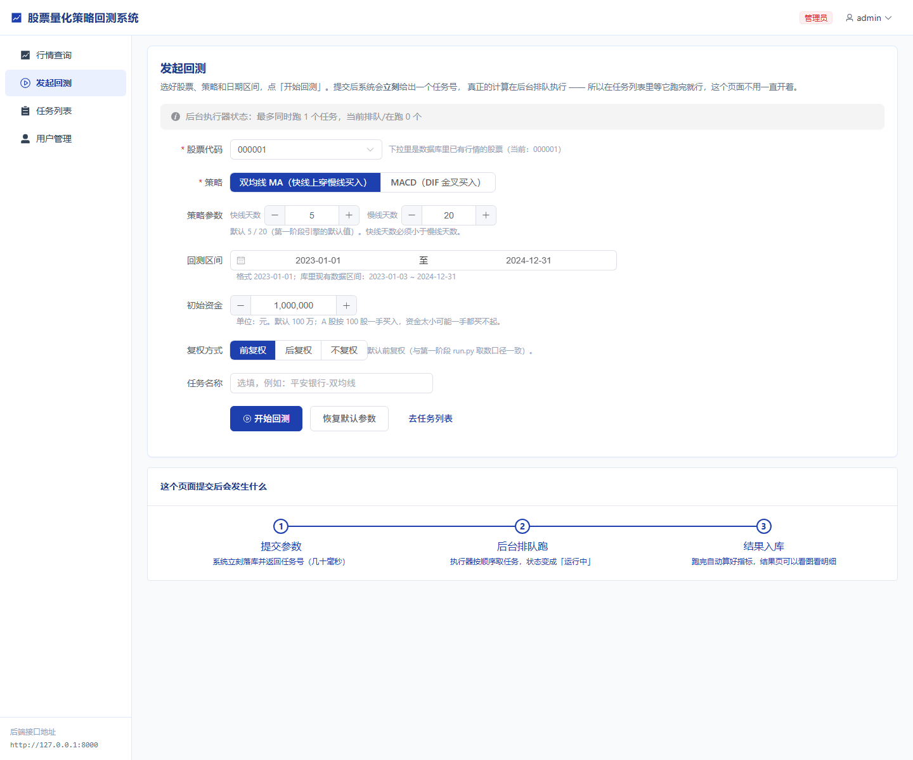
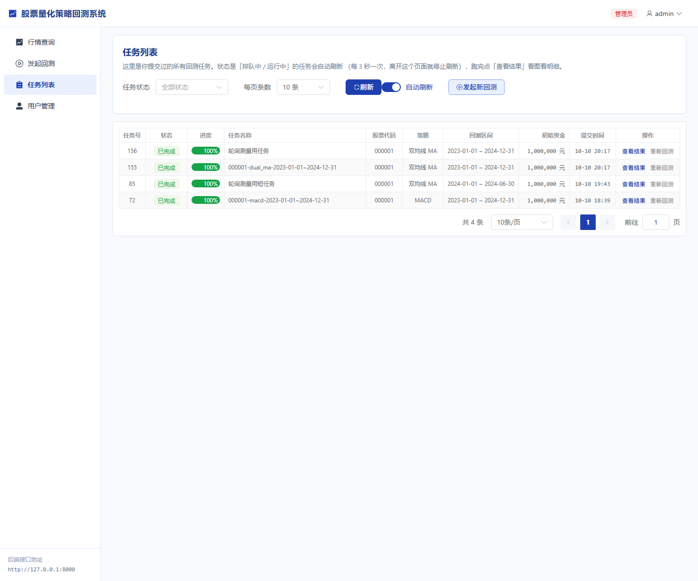
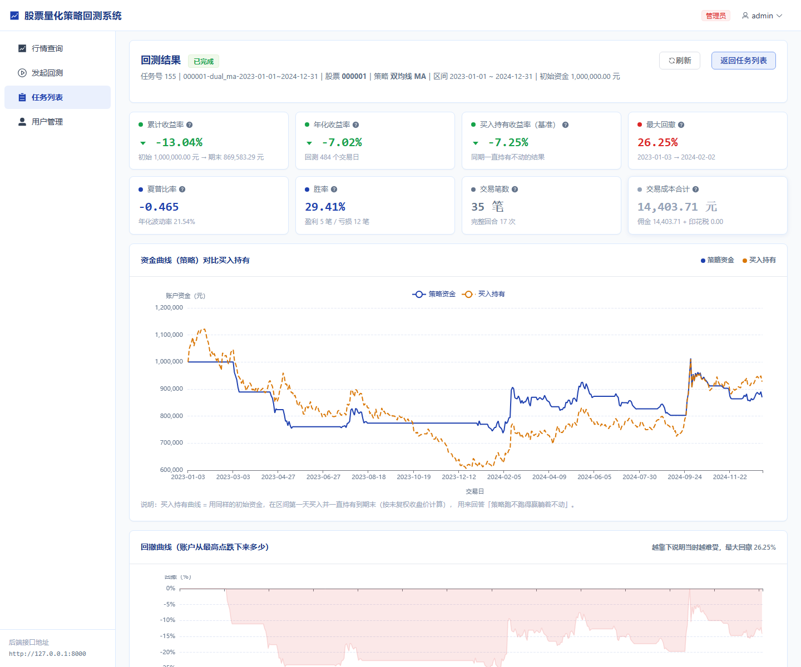
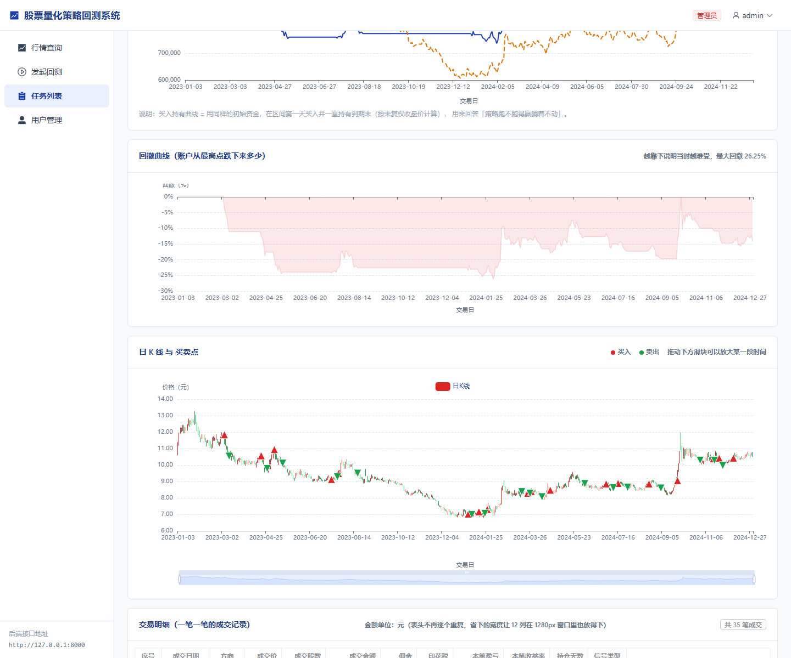
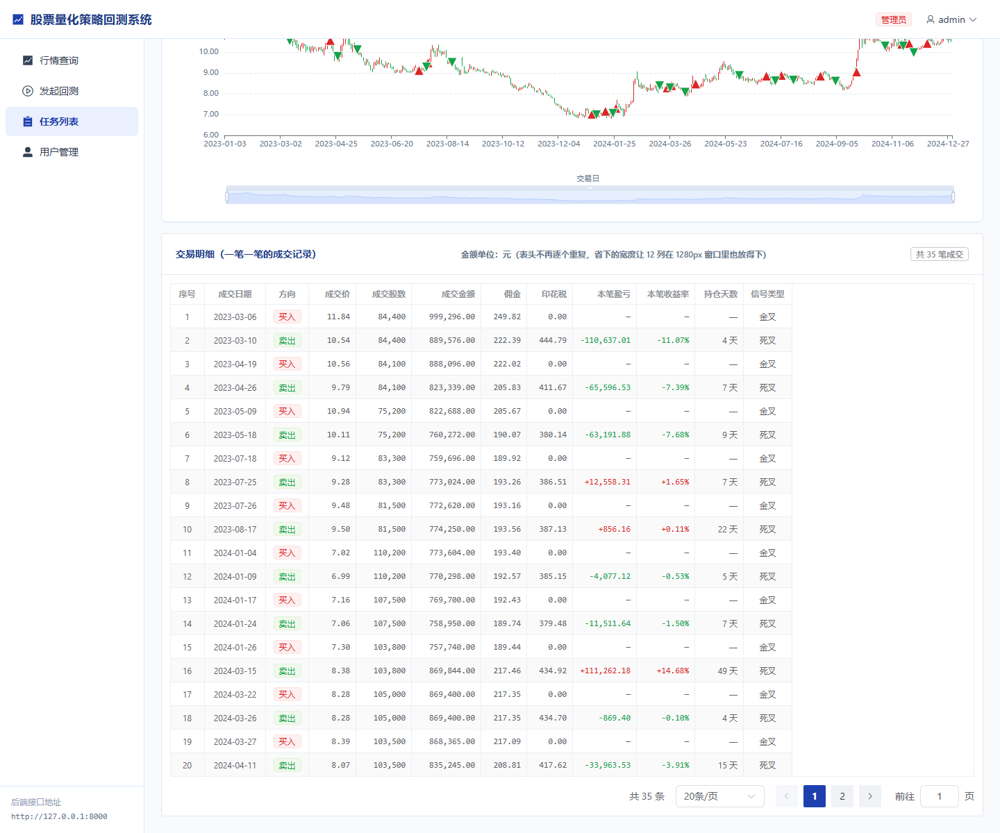
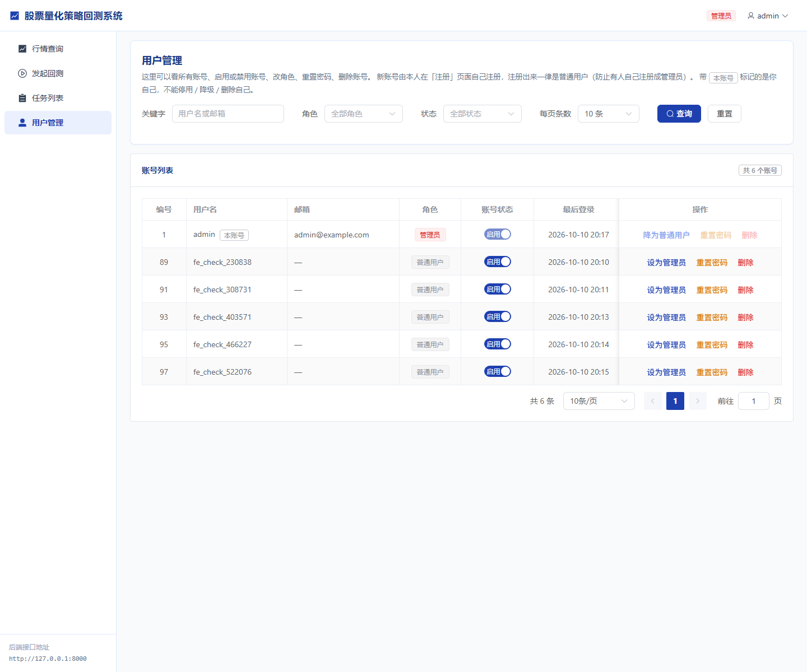

# 股票量化策略回测系统 · 项目展示

> 一个**可运行的全栈系统**：Python 量化回测引擎 + FastAPI 后端 + Vue 3 前端 + MySQL。
> 本仓库**只放界面截图与项目说明**（源码私有，可现场演示 / 可按需申请访问）。
> 作者：陈鹏安 · 广州工商学院 · 网络工程 · 2027 届

---

## 一句话

从**行情数据 → 回测引擎 → 策略与绩效指标 → 参数优化与过拟合检验 → 模拟交易与风控 → 权限与审计 → 前端可视化**，
独立完成一整套可运行、可测试、可复现的系统，而不是一个只跑通一次的 Demo。

## 系统规模

| 项 | 数量 |
|---|---|
| 后端接口 | **78 个接口路径**（FastAPI，`/docs` 中文界面） |
| 数据表 | **20 张**（MySQL 8.0，全字段中文注释） |
| 前端页面 | **17 个**（Vue 3 + Element Plus + ECharts） |
| 交易策略 | **8 个**（双均线 / MACD / KDJ / RSI / 布林带 / 网格 / 动量突破 / 均值回归） |
| 绩效指标 | **15 项**（收益、风险、风险调整后收益、交易成本四个维度） |
| 行情数据 | 真实 A 股 **36 只标的 · 17,424 行**日线（2023-01-03 ~ 2024-12-31） |
| 自动化测试 | **466 项**（139 Web E2E + 80 接口冒烟 + 12 建表自检 + 235 量化单元） |

## 核心能力

**① 事件驱动回测引擎**
按交易日撮合、次日开盘成交、A 股整手（100 股）、T+1、佣金与印花税；逐笔成交明细 + 资金曲线。
作废的信号会**分类说明原因**（资金不足 / 超时以次交易日价成交），不是只丢一句"作废"。

**② 策略库可扩展，引擎零改动**
新增 8 个策略时回测引擎**一行未改**（引擎文件 SHA256 全程未变）——用哈希值作为"可扩展性"的客观证据。

**③ 参数优化 + 过拟合检验**
按时间 70/30 切分，**只用训练段挑参数**，样本外验证；自动输出中文过拟合告警（含风险等级）。
反向验证：把测试段价格人为放大 3 倍 → 最优参数不变、而测试期指标确实变化 → 证明"没有偷看测试段"。

**④ 模拟交易 + 风控**
账户 / 下单 / 撤单 / 持仓 / 委托 / 成交；11 条风控规则（4 条 A 股硬规则不可关 + 7 条可配）。
**只拦买入、卖出放行**（能卖才能止损），每次拦截留下中文原因。

**⑤ 权限与审计**
三级角色（管理员 / 交易员 / 只读）；**22 个接口 × 4 个角色 = 88 次真实请求逐格验证，不符 0 格**。
审计日志覆盖 16 类动作，**密码与 token 零入库**（6 种特征串实测出现次数全为 0）。

**⑥ 实时推送**
WebSocket 推送任务进度 / 行情 / 交易；断线重连用 `resume(last_seq)` 补发漏掉的推送；
推送不可用自动回落 3 秒轮询（不依赖单一通道）。

**⑦ 研究能力**
机器学习择时（严格样本外，如实结论：**没跑赢**买入持有）、多因子 IC/IR 与分层回测（如实结论：9 个因子里只有 1 个"弱有效"）。

## 测试与质量（我最看重的部分）

- **139 项**无头浏览器端到端测试：含权限可见性、刷新后菜单自愈、令牌失效跳登录
- **80 项**接口冒烟（冷启动 / 热启动两种顺序各跑一遍）
- **12 项**建表自检 + **235 项**量化层单元测试
- **习惯做负向对照**：故意把代码改坏，确认断言真的会变红 —— 而不是"跑绿了就算过"
- 关键数字均与直接运行脚本的结果**逐位核对一致**

## 界面截图

| 登录 | 行情查询 |
|---|---|
|  |  |

| 发起回测 | 任务列表 |
|---|---|
|  |  |

| 结果 · 指标 | 结果 · 资金曲线 |
|---|---|
|  |  |

| 结果 · K 线买卖点 | 用户管理（仅管理员） |
|---|---|
|  |  |

展开全部 19 张截图

| 文件 | 说明 |
|---|---|
| `01-login.png` | 登录页 |
| `02-register.png` | 注册页（注册默认只读角色） |
| `03-market.png` | 行情查询（484 个交易日） |
| `04-market-empty.png` | 查不到数据的空态 |
| `05-backtest-form.png` | 发起回测（策略与参数来自接口，无硬编码） |
| `06-task-submitted.png` | 提交后立即返回任务号（异步，不卡页面） |
| `06b-task-list-1440.png` / `06c-task-list-1280.png` | 任务列表在两档分辨率下的适配 |
| `07-task-done.png` | 任务完成态（3 秒轮询 / WebSocket 推送） |
| `08-result-metrics.png` | 结果页 15 项指标 |
| `09-result-equity.png` | 资金曲线（对比买入持有基准） |
| `10-result-kline.png` | K 线 + 买卖点标记 |
| `11-admin-users.png` / `11b-admin-after.png` | 用户管理（禁用/启用、改角色、重置密码、删除） |
| `12-user-menu.png` | 普通用户菜单（比管理员少） |
| `13-forbidden.png` | 普通用户硬闯管理页 → 被拦 |
| `14-token-expired.png` | 令牌失效 → 自动清令牌并跳登录 |
| `15-logout.png` | 退出登录 |
| `16-refresh-keeps-login.png` | 刷新页面保持登录 |

## 技术栈

- **后端**：Python 3.13 · FastAPI · SQLAlchemy 2.x · Pydantic · JWT（HS256）· PBKDF2 密码哈希
- **数据库**：MySQL 8.0（InnoDB + utf8mb4，全字段中文注释）
- **前端**：Vue 3 · Vite · Element Plus · ECharts · axios · vue-router
- **量化**：pandas · numpy（纯 numpy 实现逻辑回归/决策树/随机森林，无额外依赖）
- **测试**：无头浏览器 E2E · 接口冒烟脚本 · 数据库自检脚本
- **工具**：Git · Linux 常用命令 · Docker（基础）

## 说明

- 本仓库**不含源码**：源码为私有仓库，可在面试时现场演示或按需授权访问。
- 截图中的账号信息为演示数据。

## 联系

- 手机：19065265781
- 邮箱：hunbo@qq.com
- GitHub：https://github.com/penganchen6-sudo
